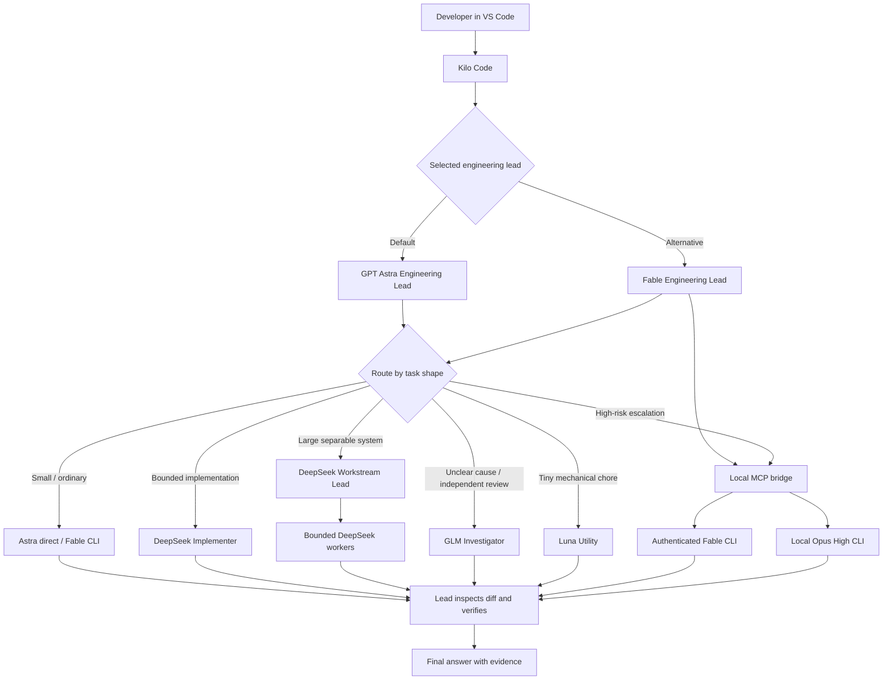

# VS Code Configuration


A reproducible, security-conscious blueprint for the VS Code workflows used on this machine. It includes the Kilo Code Astra/Fable setup and a native Claude Code extension setup where Fable supervises bounded Opus and Sonnet agents.

> This repository contains sanitized examples only. API keys, OAuth tokens, account identifiers, logs, chat history, and machine-specific credentials are deliberately excluded.

## Why this setup works

The selected engineering lead remains responsible for the whole task. It handles ordinary work directly and delegates only when the work is large enough, separable enough, or risky enough to justify the coordination cost.



## Agent roles

| Role | Best use | Important boundary |
|---|---|---|
| Astra Engineering Lead | Default planning, direct implementation, integration, final verification | Delegates only when useful |
| Fable Engineering Lead | Full-session lead whose primary work runs through authenticated local Fable CLI | Reports bridge failures; never silently switches providers |
| DeepSeek Implementer | Substantial but well-bounded coding | Exclusive file ownership; cannot delegate |
| DeepSeek Workstream Lead | Large work with multiple independent streams | Coordinates bounded workers; cannot create another lead |
| GLM Investigator | Read-only tracing, diagnosis, and review | Cannot edit files |
| Luna Utility | Tiny deterministic chores | Not for architecture, debugging, or broad edits |
| Local Claude CLI | Difficult architecture/security/concurrency escalation or standalone profile | Runs outside Kilo's native shared-agent board |

## Operating principles

- Direct first: small tasks stay with the lead.
- One writer per file or subsystem.
- Delegation assignments include scope, constraints, deliverables, and checks.
- Worker summaries are evidence leads to inspect, not proof by themselves.
- Verification is proportional to risk.
- Every user-facing reply follows the `Answer` → `My opinion` → `Next step` contract unless the user requests another format.
- No deprecated Orchestrator mode is required; the lead performs orchestration when needed.
- Credentials remain in provider keychains/auth stores and never in this repository.

## Quick start

1. Install VS Code, Kilo Code, and any provider CLIs you intend to use.
2. Install the global coding policy and chat response-style instructions.
3. Copy `examples/kilo.jsonc` to `~/.config/kilo/kilo.jsonc` and replace every placeholder.
4. Copy the files under `examples/agent/` to `~/.config/kilo/agent/`.
5. Merge the relevant keys from `examples/vscode/settings.jsonc` into VS Code user settings.
6. Configure the local Claude CLI bridge and authenticate providers outside Git.
7. Optionally apply the version-sensitive remember-last-agent patch.
8. Restart VS Code, select **Astra Engineering Lead**, and run the scenario checks.

Run the repository's static and bridge-protocol checks at any time with `./scripts/verify.sh`.

The native Claude Code extension snapshot is under [`claude-code/`](claude-code/README.md).

Browser automation and macOS computer use are documented under [`agent-vision/`](agent-vision/README.md).

## Documentation

- [Architecture](docs/architecture.md)
- [Task routing and operating process](docs/task-routing.md)
- [Installation and recovery](docs/installation.md)
- [Local Claude CLI bridge](docs/local-cli-bridge.md)
- [Agent vision: browser and computer use](agent-vision/README.md)
- [VS Code settings](docs/vscode-settings.md)
- [Remember-last-agent patch](docs/remember-last-agent-patch.md)
- [Scenario checklist](docs/scenario-checklist.md)
- [Configuration inventory](docs/configuration-inventory.md)
- [Security and secret handling](SECURITY.md)

## Repository map

```text
.
├── README.md
├── SECURITY.md
├── THIRD_PARTY_NOTICES.md
├── assets/                  # GitHub-ready vector artwork
├── diagrams/                # Editable Mermaid diagram sources
├── docs/                    # Architecture and operating guides
├── claude-code/             # Native Claude Code extension state and agents
├── agent-vision/            # Browser automation, computer use, guardrail hooks
├── scripts/                 # Runnable repository verification
├── third-party/             # Required third-party license notices
└── examples/
    ├── kilo.jsonc           # Sanitized Kilo configuration
    ├── agent/               # Lead and specialist definitions
    ├── bridges/             # Local CLI MCP bridge
    ├── instructions/        # Coding and chat-output contracts
    ├── patches/             # Optional version-sensitive UI patch
    └── vscode/              # Relevant VS Code user settings
```

## Versioning note

Model names, extension directories, and provider identifiers can change. Treat the examples as a known-good architectural pattern and verify the currently available model IDs before applying them to a different machine.
