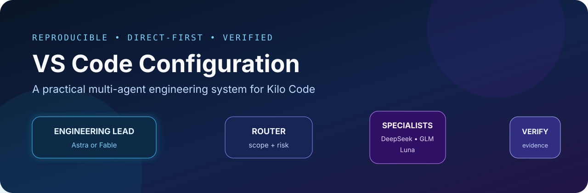
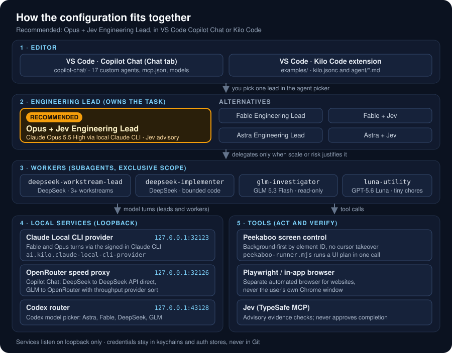
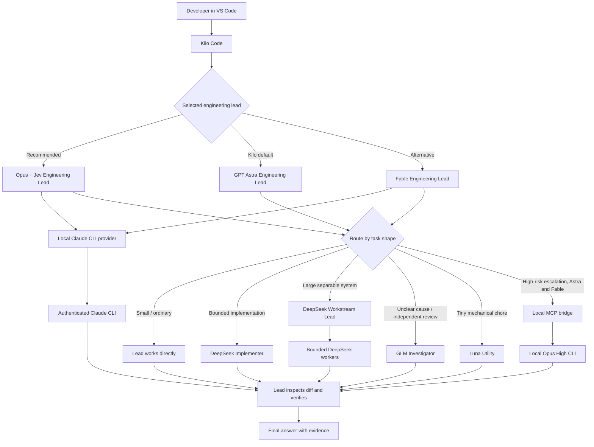

# VS Code Configuration



A reproducible, security-conscious blueprint for the VS Code workflows used on this machine. The current Kilo setup includes CTO agents, isolated workers, shared computer control and prompt clarification. Earlier Astra/Fable/Opus configurations, native Claude Code and VS Code Chat (Copilot) examples remain available.

> This repository contains sanitized examples only. API keys, OAuth tokens, account identifiers, logs, chat history, and machine-specific credentials are deliberately excluded.



## Start here

**Latest snapshot: [2026-10-14](docs/updates/2026-10-14.md)** · Git tag `config-2026-10-14` · [Dated change index](docs/configuration-history.md).

**Speed and reading:** [Local CLI bridge latency](docs/local-cli-bridge.md#response-latency-2026-10-13) replies on the result line, shows progress after 1.5 s and reuses one CLI process per chat. [Chat UI patches](docs/chat-ui-patches.md) add skim mode, the Hanken Grotesk chat font and a predicted next message.

**Prompt and context:** [Clarify goal](docs/clarify-goal.md) adds an editable preview using DeepSeek on LithosAI, supported attachments and recent chat, with a visible Stop control. [Goal continuity](docs/goal-continuity.md) preserves the active objective and shares the canonical Ponytail policy.

**Current Kilo setup:** [CTO (Recommended) and CTO + JEV](docs/cto-setup.md) replace the six older custom picker entries. [Native Kilo delegation](docs/cto-native.md) uses visible child agents and Agent Manager worktrees where isolation is needed. Fourteen workers / six writers is a scheduling policy in native chat; the separate isolated MCP scheduler enforces its own limits for terminal workflows. The older engineering-lead documentation below remains for the previous setup and Copilot configuration.

**Small-edit experiment:** [Cross-test findings](docs/cto-small-changes.md) cover speed, ambiguity and incorrect edits. The proposed workflow is **not activated** because the ambiguous-image test failed.

**Minimal CTO pilot:** [Setup and results](docs/cto-minimal.md) describe an opt-in, single-agent VS Code terminal task that omits the extra workflow layers. The existing picker and default remain unchanged; ambiguity failures prevent promotion.

**Adaptive CTO:** [Three VS Code task routes](docs/cto-adaptive.md) add coordinated CTO work, repeatable DeepSeek edits and Luna mechanical work. Routine changes use scoped snapshots, agreed verification and guarded publication; the premium CTO is consulted only when needed. These terminal tasks are separate from the native chat picker.

**Shared computer tools:** [Computer control setup](docs/computer-control-setup.md) adds one coordinated desktop/browser operator across Kilo, Claude Code and Codex. See the [implementation and test checklist](docs/computer-control-todo.md).

| I want to… | Go to |
|---|---|
| Use the recommended Kilo setup | [CTO setup](docs/cto-setup.md) |
| Install everything on a new Mac | [Quick start](#quick-start), then [Installation and recovery](docs/installation.md) |
| Set up VS Code Copilot Chat | [`copilot-chat/README.md`](copilot-chat/README.md) |
| Restore the setup from a past date | [Configuration history](docs/configuration-history.md) |
| Understand how requests are routed | [Architecture](docs/architecture.md) and [Task routing](docs/task-routing.md) |
| Drive the screen or a browser | [Shared computer control](docs/computer-control-setup.md); [older agent-vision setup](agent-vision/README.md) |
| Set up the Claude Code extension | [`claude-code/README.md`](claude-code/README.md) |
| Run Hermes Agent in VS Code (ACP) | [`hermes/README.md`](hermes/README.md) |
| Check the repository | `bash scripts/verify.sh` |

## Previous setup: Opus + Jev Engineering Lead

**What it is.** The engineering lead used day to day, in both VS Code Copilot Chat and Kilo Code. It runs on Claude Opus 5.5 High through the authenticated local Claude CLI (Claude Local CLI provider, `127.0.0.1:32123`) and consults Jev (TypeSafe) only as an advisory evidence check.

**How it routes.** It works directly by default. It hands one bounded subsystem to `deepseek-implementer`, uses `deepseek-workstream-lead` only for three or more independent workstreams, `glm-investigator` for read-only diagnosis, and `luna-utility` for tiny chores. It is already Opus, so it has no Opus escalation lane. It never falls back silently to another Claude route.

**Screen control without taking your cursor.** Native apps are driven through Peekaboo's background delivery by element ID, and multi-step UI tasks run as one JSON plan through `peekaboo-runner.mjs`. Websites use a separate automated browser (Playwright MCP or the in-app browser pane). It announces or asks before it ever takes the real cursor.

**Where its files live.**

- Kilo agent: [`examples/agent/Opus + Jev Engineering Lead.md`](examples/agent/Opus%20+%20Jev%20Engineering%20Lead.md)
- Copilot Chat agent: [`copilot-chat/config/prompts/opus-jev-engineering-lead.agent.md`](copilot-chat/config/prompts/opus-jev-engineering-lead.agent.md)
- Screen runner: [`examples/bridges/peekaboo-runner.mjs`](examples/bridges/peekaboo-runner.mjs) (live copy `~/.config/kilo/bridges/peekaboo-runner.mjs`)
- Details and limits: [Opus + Jev variant](docs/astra-jev.md#opus--jev-variant)

## Why this setup works

The selected engineering lead remains responsible for the whole task. It handles ordinary work directly and delegates only when the work is large enough, separable enough, or risky enough to justify the coordination cost.



## Agent roles

| Role | Best use | Important boundary |
|---|---|---|
| Opus + Jev Engineering Lead | Recommended lead: Opus 5.5 High through the local Claude CLI, advisory Jev checks, background screen control | No Opus escalation lane; Jev never approves completion |
| Astra Engineering Lead | Kilo default: planning, direct implementation, integration, final verification | Delegates only when useful |
| Fable Engineering Lead | Full-session lead whose primary work runs through authenticated local Fable CLI | Reports bridge failures; never silently switches providers |
| Fable + Jev, Astra + Jev | The same leads with advisory Jev (TypeSafe) evidence checks | Jev is advisory only |
| DeepSeek Implementer | Substantial but well-bounded coding | Exclusive file ownership; cannot delegate |
| DeepSeek Workstream Lead | Large work with multiple independent streams | Coordinates bounded workers; cannot create another lead |
| GLM Investigator | Read-only tracing, diagnosis, and review | Cannot edit files |
| Luna Utility | Tiny deterministic chores | Not for architecture, debugging, or broad edits |
| Local Claude CLI | Difficult architecture/security/concurrency escalation or standalone profile | Runs outside Kilo's native shared-agent board |

## Operating principles

- Direct first: small tasks stay with the lead.
- One writer per file or subsystem.
- Delegation assignments include scope, constraints, deliverables, and checks.
- Worker summaries are evidence leads to inspect, not proof by themselves.
- Verification is proportional to risk.
- Every user-facing reply follows the `Answer` → `My opinion` → `Next step` contract unless the user requests another format.
- No deprecated Orchestrator mode is required; the lead performs orchestration when needed.
- Credentials remain in provider keychains/auth stores and never in this repository.

## Quick start

1. Install VS Code, Kilo Code, and any provider CLIs you intend to use.
2. Install the global coding policy and chat response-style instructions.
3. Copy `examples/kilo.jsonc` to `~/.config/kilo/kilo.jsonc` and replace every placeholder.
4. Copy the files under `examples/agent/` to `~/.config/kilo/agent/`.
5. Merge the relevant keys from `examples/vscode/settings.jsonc` into VS Code user settings.
6. Configure the local Claude CLI bridge and authenticate providers outside Git.
7. Optionally install the Kilo bundle patches under `examples/patches/`; LaunchAgent `ai.kilo.reapply-patches` runs `scripts/reapply-kilo-patches.sh` to re-apply them after each Kilo auto-update.
8. Copy `examples/bridges/peekaboo-runner.mjs` to `~/.config/kilo/bridges/` for the Opus + Jev screen runner.
9. Restart VS Code, select **Opus + Jev Engineering Lead** (or the Kilo default, **Astra Engineering Lead**), and run the scenario checks.

Run the repository's static and bridge-protocol checks at any time with `./scripts/verify.sh`.

The native Claude Code extension snapshot is under [`claude-code/`](claude-code/README.md).

VS Code's built-in Chat view (Copilot Chat, plus Peekaboo for the Claude Code and Codex tabs) is under [`copilot-chat/`](copilot-chat/README.md): run `bash copilot-chat/scripts/install.sh --dry-run`, then without `--dry-run`, then finish its UI steps. DeepSeek and GLM run through the local OpenRouter speed proxy (`127.0.0.1:32126`): DeepSeek goes straight to the DeepSeek API, and GLM needs OpenRouter added under Manage Models > Add Models with your own key, with "Z.ai: GLM 5.3 Flash" (`z-ai/glm-5.3-flash`) pinned as the fallback. Its settings also turn off the chat and terminal accessibility sounds that `editor.accessibilitySupport: "on"` makes audible.

`examples/kilo.jsonc` also includes the OpenAI-compatible PrimalLabs provider: MiMo V2.6 Pro RL and DeepSeek V4 Flash 0731. A short live Kilo response from the PrimalLabs DeepSeek route reached 354.3 tok/s on 2026-09-28; treat that as an observed interactive rate, not a benchmark.

Browser automation and macOS computer use are documented under [`agent-vision/`](agent-vision/README.md).

## Documentation

- [Configuration history: dated setups and how to restore them](docs/configuration-history.md)
- [Astra, Fable and Opus + Jev Engineering Leads: installation, limits, and verified behavior](docs/astra-jev.md)
- [Codex model picker: Astra and Fable leads, DeepSeek and GLM](docs/codex-model-picker.md)
- [Architecture](docs/architecture.md)
- [Task routing and operating process](docs/task-routing.md)
- [Installation and recovery](docs/installation.md)
- [Local Claude CLI bridge](docs/local-cli-bridge.md)
- [Codex working-status patch](docs/codex-thinking-status-patch.md)
- [Agent vision: browser and computer use](agent-vision/README.md)
- [VS Code Chat (Copilot, Claude Code, Codex tabs) setup](copilot-chat/README.md)
- [VS Code settings](docs/vscode-settings.md)
- [Scenario checklist](docs/scenario-checklist.md)
- [Configuration inventory](docs/configuration-inventory.md)
- [Security and secret handling](SECURITY.md)

## Repository map

```text
.
├── README.md
├── SECURITY.md
├── THIRD_PARTY_NOTICES.md
├── assets/                  # GitHub-ready vector artwork (hero.svg, architecture.svg)
├── diagrams/                # Editable Mermaid diagram sources
├── docs/                    # Architecture, operating guides, configuration history
├── claude-code/             # Native Claude Code extension state and agents
├── copilot-chat/            # VS Code Chat (Copilot) agents, models, MCP, settings, installer
├── agent-vision/            # Browser automation, computer use, guardrail hooks
├── scripts/                 # verify.sh, tests, reapply-kilo-patches.sh
├── third-party/             # Required third-party license notices
└── examples/
    ├── kilo.jsonc           # Sanitized Kilo configuration
    ├── agent/               # Lead and specialist definitions
    ├── bridges/             # Claude CLI bridge, speed proxy, Jev MCP, peekaboo-runner.mjs
    ├── codex-router/        # Codex model picker router
    ├── instructions/        # Coding and chat-output contracts
    ├── patches/             # Optional version-sensitive Kilo patches and checks
    ├── mockups/             # Static HTML previews of proposed UI changes
    └── vscode/              # VS Code user settings (Kilo and Claude Code keys)
```

## Versions and dated configurations

Every dated configuration has a Git tag, `config-YYYY-MM-DD`. See [Configuration history](docs/configuration-history.md) for what each date contained and how to restore it (`git fetch --tags`, then `git checkout config-YYYY-MM-DD`).

Model names, extension directories, and provider identifiers can change. Treat the examples as a known-good architectural pattern and verify the currently available model IDs before applying them to a different machine.
