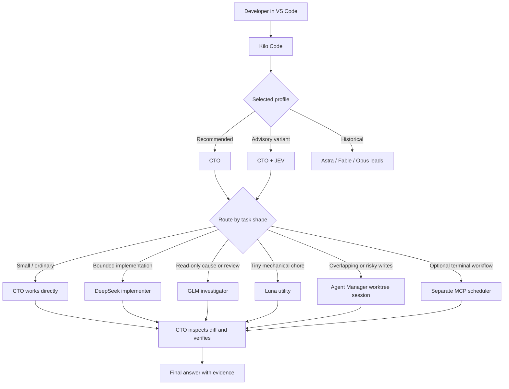

# VS Code Configuration


A reproducible, security-conscious blueprint for one custom VS Code and Kilo Code setup. The current Kilo setup includes CTO agents, isolated workers, shared computer control and prompt clarification. Earlier Astra/Fable/Opus configurations, native Claude Code and VS Code Chat (Copilot) examples remain available as historical references.

This is a personal configuration repository, not an official VS Code, Kilo Code, Claude, or Copilot feature. Some options patch the installed Kilo extension bundle and are version-sensitive; they can stop working after an update.

> This repository contains sanitized examples only. API keys, OAuth tokens, account identifiers, logs, chat history, and machine-specific credentials are deliberately excluded. Use credentials only for the provider routes you choose, and keep their values outside this repository.


## Start here

**Latest snapshot: [2026-10-18](docs/updates/2026-10-18.md)** · Kilo Code 7.8.12 · Git tag `config-2026-10-18` · [Dated change index](docs/configuration-history.md). Older notes describe 7.7.2 and 7.8.2 and are marked as historical where they differ.

**Speed and reading:** [Local CLI bridge latency](docs/local-cli-bridge.md#response-latency-2026-10-13) replies on the result line, shows progress after 1.5 s and reuses one CLI process per chat. [Chat UI patches](docs/chat-ui-patches.md) add skim mode, the Hanken Grotesk chat font and a predicted next message.

**Prompt and context:** [Clarify goal](docs/clarify-goal.md) adds an editable preview using DeepSeek on LithosAI, supported attachments and recent chat, with a visible Stop control. [Goal continuity](docs/goal-continuity.md) preserves the active objective and shares the canonical Ponytail policy.

**Current Kilo setup:** [CTO (Recommended) and CTO + JEV](docs/cto-setup.md) replace the six older custom picker entries. [Native Kilo delegation](docs/cto-native.md) uses visible child agents and Agent Manager worktrees where isolation is needed. Fourteen workers / six writers is a scheduling policy in native chat; the separate isolated MCP scheduler enforces its own limits for terminal workflows. The older engineering-lead documentation below remains for the previous setup and Copilot configuration.

**Small-edit experiment:** [Cross-test findings](docs/cto-small-changes.md) cover speed, ambiguity and incorrect edits. The proposed workflow is **not activated** because the ambiguous-image test failed.

**Minimal CTO pilot:** [Setup and results](docs/cto-minimal.md) describe an opt-in, single-agent VS Code terminal task that omits the extra workflow layers. The existing picker and default remain unchanged; ambiguity failures prevent promotion.

**Adaptive CTO:** [Three VS Code task routes](docs/cto-adaptive.md) add coordinated CTO work, repeatable DeepSeek edits and Luna mechanical work. Routine changes use scoped snapshots, agreed verification and guarded publication; the premium CTO is consulted only when needed. These terminal tasks are separate from the native chat picker.

**Shared computer tools:** [Computer control setup](docs/computer-control-setup.md) adds one coordinated desktop/browser operator across Kilo, Claude Code and Codex. See the [implementation and test checklist](docs/computer-control-todo.md).

| I want to… | Go to |
|---|---|
| Use the recommended Kilo setup | [CTO setup](docs/cto-setup.md) |
| Install on a new machine | [Quick start](#quick-start), then [Installation and recovery](docs/installation.md) |
| Set up VS Code Copilot Chat | [`copilot-chat/README.md`](copilot-chat/README.md) |
| Restore the setup from a past date | [Configuration history](docs/configuration-history.md) |
| Understand how requests are routed | [Architecture](docs/architecture.md) and [Task routing](docs/task-routing.md) |
| Drive the screen or a browser | [Shared computer control](docs/computer-control-setup.md); [older agent-vision setup](agent-vision/README.md) |
| Set up the Claude Code extension | [`claude-code/README.md`](claude-code/README.md) |
| Run Hermes Agent in VS Code (ACP) | [`hermes/README.md`](hermes/README.md) |
| Check the repository | `bash scripts/verify.sh` |

## Historical setup: Opus + Jev Engineering Lead

This section and the older engineering-lead material below describe the configuration before the 2026-10-09 CTO replacement. They are retained for reference and dated restoration, not as the current install path.

**What it is.** The engineering lead used before the CTO profiles, in both VS Code Copilot Chat and Kilo Code. It runs on Claude Opus 5.5 High through the authenticated local Claude CLI (Claude Local CLI provider, `127.0.0.1:32123`) and consults Jev (TypeSafe) only as an advisory evidence check.

**How it routes.** It works directly by default. It hands one bounded subsystem to `deepseek-implementer`, uses `deepseek-workstream-lead` only for three or more independent workstreams, `glm-investigator` for read-only diagnosis, and `luna-utility` for tiny chores. It is already Opus, so it has no Opus escalation lane. It never falls back silently to another Claude route.

**Screen control without taking your cursor.** Native apps are driven through Peekaboo's background delivery by element ID, and multi-step UI tasks run as one JSON plan through `peekaboo-runner.mjs`. Websites use a separate automated browser (Playwright MCP or the in-app browser pane). It announces or asks before it ever takes the real cursor.

**Where its files live.**

- Kilo agent: [`examples/agent/Opus + Jev Engineering Lead.md`](examples/agent/Opus%20+%20Jev%20Engineering%20Lead.md)
- Copilot Chat agent: [`copilot-chat/config/prompts/opus-jev-engineering-lead.agent.md`](copilot-chat/config/prompts/opus-jev-engineering-lead.agent.md)
- Screen runner: [`examples/bridges/peekaboo-runner.mjs`](examples/bridges/peekaboo-runner.mjs) (live copy `~/.config/kilo/bridges/peekaboo-runner.mjs`)
- Details and limits: [Opus + Jev variant](docs/astra-jev.md#opus--jev-variant)

## Why this setup works

The selected engineering lead remains responsible for the whole task. It handles ordinary work directly and delegates only when the work is large enough, separable enough, or risky enough to justify the coordination cost.



## Agent roles

| Role | Best use | Important boundary |
|---|---|---|
| CTO (Recommended) | Current lead: selected chat model, direct execution, visible native workers | Fourteen-worker / six-writer scheduling is policy, not a native runtime cap |
| CTO + JEV | Same execution policy with selective TypeSafe/JEV advice | Jev is advisory only; it never certifies completion |
| DeepSeek Implementer | Substantial but well-bounded coding | Leaf worker; exclusive file ownership; cannot delegate |
| GLM Investigator | Read-only tracing, diagnosis, and review | Cannot edit files or run executable checks |
| Luna Utility | Tiny deterministic chores | Not for architecture, debugging, or broad edits |
| Astra / Fable / Opus + Jev leads | Historical profiles retained in dated configurations | Not the current default; see [historical setup](docs/astra-jev.md) |

## Operating principles

- Direct first: small tasks stay with the lead.
- One writer per file or subsystem.
- Delegation assignments include scope, constraints, deliverables, and checks.
- Worker summaries are evidence leads to inspect, not proof by themselves.
- Verification is proportional to risk.
- Every user-facing reply follows the `Answer` → `My opinion` → `Next step` contract unless the user requests another format.
- No deprecated Orchestrator mode is required; the lead performs orchestration when needed.
- Credentials remain in provider keychains/auth stores and never in this repository.

## Quick start

The current setup is **CTO (Recommended)** and **CTO + JEV** with native Kilo workers. The installer merges into an existing live configuration, so preview it before applying.

1. Install VS Code, Kilo Code, and Node.js. macOS is required only for the optional Peekaboo screen control and any macOS service you create; Node.js is required for the installers and checks. Chrome and Playwright are needed for safe patch rendering and the complete verification suite; the profile installer itself does not need them.
2. Clone or download this repository, then open a terminal in its root.
3. Install Kilo and back up the current configuration:

   ```sh
   node --version
   mkdir -p ~/.config/kilo
   if [ -d ~/.config/kilo ]; then cp -R ~/.config/kilo ~/.config/kilo.backup-$(date +%Y%m%d-%H%M%S); fi
   ```

4. Copy the global instructions and create the base Kilo config. If `~/.config/kilo/kilo.jsonc` already exists, keep it; the installer preserves its installed routes. For a new machine, copy `examples/kilo.jsonc` and replace every placeholder.

   ```sh
   mkdir -p ~/.config/ponytail ~/.config/kilo
   cp examples/instructions/AGENTS.md ~/.config/ponytail/AGENTS.md
   cp examples/instructions/chat-response-style.md ~/.config/kilo/chat-response-style.md
   # New installation only; skip when a live kilo.jsonc already exists.
   if [ ! -f ~/.config/kilo/kilo.jsonc ]; then cp examples/kilo.jsonc ~/.config/kilo/kilo.jsonc; fi
   ```

5. Preview the current CTO installation, then apply it:

   ```sh
   node scripts/install-cto.mjs            # inspect targets and changes
   node scripts/install-cto.mjs --apply    # back up, then install
   ```

   `--profiles-only --apply` upgrades the native profiles without replacing a running MCP scheduler. Full details, including the separate terminal scheduler and restoration, are in [CTO setup](docs/cto-setup.md).

6. Merge only the relevant keys from `examples/vscode/settings.jsonc` into VS Code user settings. Review auto-approval, desktop-control, and file-history permissions before adopting them; see [Security](SECURITY.md).
7. Authenticate only the provider routes you intend to use through Kilo's provider UI or the provider's official CLI. Never put keys or tokens in `kilo.jsonc`, agent files, or this repository.
8. In an idle Kilo window run **Kilo Code: Reload Config and Skills**, then start a fresh chat and select **CTO (Recommended)** or **CTO + JEV**. Existing chats may retain their old agent.
9. Run the smoke checks in [Installation and recovery](docs/installation.md#smoke-checks). Run `./scripts/verify.sh` for the repository's static, protocol, and fixture checks.

Optional extra bridges and screen tooling are documented in [Installation](docs/installation.md). Custom bundle patches are not stock Kilo features and are not required for the CTO profiles.

The historical Astra/Fable/Opus leads are described in [Astra, Fable and Opus + Jev](docs/astra-jev.md). They are not the current default.

The native Claude Code extension snapshot is under [`claude-code/`](claude-code/README.md).

VS Code's built-in Chat view (Copilot Chat, plus Peekaboo for the Claude Code and Codex tabs) is under [`copilot-chat/`](copilot-chat/README.md): run `bash copilot-chat/scripts/install.sh --dry-run`, then without `--dry-run`, then finish its UI steps. DeepSeek and GLM run through the local OpenRouter speed proxy (`127.0.0.1:32126`): DeepSeek goes straight to the DeepSeek API, and GLM needs OpenRouter added under Manage Models > Add Models with your own key, with "Z.ai: GLM 5.3 Flash" (`z-ai/glm-5.3-flash`) pinned as the fallback. Its settings also turn off the chat and terminal accessibility sounds that `editor.accessibilitySupport: "on"` makes audible.

`examples/kilo.jsonc` also includes the OpenAI-compatible PrimalLabs provider: MiMo V2.6 Pro RL and DeepSeek V4 Flash 0731. A short live Kilo response from the PrimalLabs DeepSeek route reached 354.3 tok/s on 2026-09-28; treat that as an observed interactive rate, not a benchmark.

Browser automation and macOS computer use are documented under [`agent-vision/`](agent-vision/README.md).

## Documentation

- [Configuration history: dated setups and how to restore them](docs/configuration-history.md)
- [Historical Astra, Fable and Opus + Jev leads: installation, limits, and verified behavior](docs/astra-jev.md)
- [Codex model picker: Astra and Fable leads, DeepSeek and GLM](docs/codex-model-picker.md)
- [Architecture](docs/architecture.md)
- [Task routing and operating process](docs/task-routing.md)
- [Installation and recovery](docs/installation.md)
- [Local Claude CLI bridge](docs/local-cli-bridge.md)
- [Codex working-status patch](docs/codex-thinking-status-patch.md)
- [Agent vision: browser and computer use](agent-vision/README.md)
- [VS Code Chat (Copilot, Claude Code, Codex tabs) setup](copilot-chat/README.md)
- [VS Code settings](docs/vscode-settings.md)
- [Scenario checklist](docs/scenario-checklist.md)
- [Configuration inventory](docs/configuration-inventory.md)
- [Security and secret handling](SECURITY.md)

## License

Original repository content is available under the [MIT License](LICENSE), copyright 2026 Shrikrishna Gavhane. Third-party material keeps its own license; see [Third-party notices](THIRD_PARTY_NOTICES.md) for the Ponytail policy text and the Hanken Grotesk font.

## Repository map

```text
.
├── README.md
├── LICENSE
├── SECURITY.md
├── THIRD_PARTY_NOTICES.md
├── assets/                  # GitHub-ready vector artwork (hero.svg, architecture.svg)
├── diagrams/                # Editable Mermaid diagram sources
├── docs/                    # Architecture, operating guides, configuration history
├── claude-code/             # Native Claude Code extension state and agents
├── copilot-chat/            # VS Code Chat (Copilot) agents, models, MCP, settings, installer
├── agent-vision/            # Browser automation, computer use, guardrail hooks
├── skim-mode/               # Fast-reading chat replies: guide, mockup, prompt for other apps
├── scripts/                 # verify.sh, tests, reapply-kilo-patches.sh
├── third-party/             # Required third-party license notices
└── examples/
    ├── kilo.jsonc           # Sanitized Kilo configuration
    ├── agent/               # Lead and specialist definitions
    ├── bridges/             # Claude CLI bridge, speed proxy, Jev MCP, peekaboo-runner.mjs
    ├── codex-router/        # Codex model picker router
    ├── instructions/        # Coding and chat-output contracts
    ├── patches/             # Optional version-sensitive Kilo patches and checks
    ├── mockups/             # Static HTML previews of proposed UI changes
    └── vscode/              # VS Code user settings (Kilo and Claude Code keys)
```

## Versions and dated configurations

Every dated configuration has a Git tag, `config-YYYY-MM-DD`. See [Configuration history](docs/configuration-history.md) for what each date contained and how to restore it (`git fetch --tags`, then `git checkout config-YYYY-MM-DD`).

Model names, extension directories, and provider identifiers can change. Treat the examples as a known-good architectural pattern and verify the currently available model IDs before applying them to a different machine.

Version evidence is deliberately narrow: the 2026-10-18 snapshot used Kilo Code 7.8.12, while the September 19 inventory recorded 7.7.2 and the October 9 CTO rollout recorded 7.8.2. Patches are matched to the anchors documented in their own files; there is no general compatibility claim for other builds. Run each patch's `--check` or the safe gate before installing, and leave Kilo unpatched if an anchor is not recognized.
