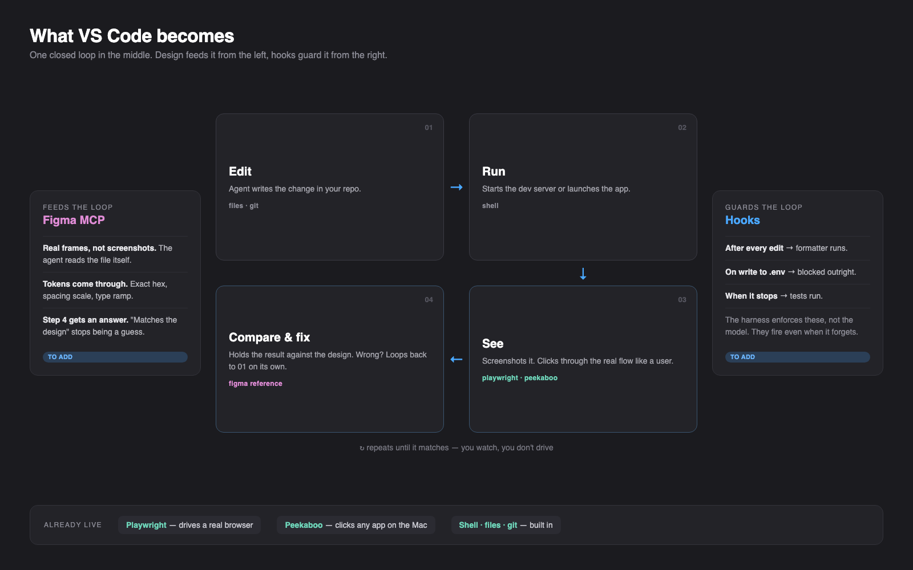

# Agent vision

This folder documents the capability set that lets the assistants in this VS
Code setup *look at* what they just built instead of reasoning about it from
source alone.

The diagram source is [`assets/visual-loop.html`](assets/visual-loop.html);
it is a plain standalone HTML file, editable in any browser, and the PNG is a
1600x1000 screenshot of it.

## What changes

Without vision, an agent's last honest statement is "the code compiles". It
writes a component, reads its own diff, and hands the result back for a human to
open. Every runtime fact — a control that renders off-screen, a form that
submits empty, a validation message that never fires — is discovered by the
person who asked for the work.

With vision the agent stops being only the author of the code and becomes its
first user. It opens the page, submits the form empty, pastes an emoji into the
phone field, kills the network mid-save, and reads back what actually happened.
Failures that used to surface in review surface one step earlier, inside the
loop, where the agent that caused them can still fix them without a round trip.

This is a narrowing of the gap between "written" and "works", not a replacement
for review. The agent still cannot tell you whether the feature was worth
building.

## The loop

1. **Edit** — the agent writes the change in the repository. Files, git.
2. **Run** — it starts the dev server or launches the app. Shell.
3. **See** — it screenshots the result and clicks through the real flow.
   Playwright for anything in a browser, Peekaboo for any other macOS app.
4. **Compare and fix** — it holds the result against the intended design and, if
   it does not match, loops back to step 1 on its own.

Steps 1 through 3 work today. Step 4 is the weak link: "matches the design" is
currently a judgement the agent makes from a prose description of the intent,
because it has no access to the design file itself. A Figma MCP server would
give it real frames and real tokens to compare against and turn step 4 from a
guess into a check. That server is not installed here; the left panel of the
diagram is labelled *to add* for that reason, and so is the hooks panel on the
right.

## Documents

- [Browser automation](browser-automation.md) — `@playwright/mcp`, 25
  `browser_*` tools, and why the MCP command needs both an absolute path and an
  explicit `PATH`.
- [Computer use](computer-use.md) — Peekaboo, 26 tools for driving any macOS
  application, the global-install decision, and the macOS permission model that
  makes the grant land on a process you did not expect.

## Scope and cost

Both servers act on the machine they run on: Playwright opens a browser that
shares nothing with your logged-in profile by default, but Peekaboo clicks,
types, and drags in your real session, against whatever window happens to be in
front of it. Treat an agent with computer use the way you would treat a shared
screen — it is useful because it is unsandboxed, and that is also the whole
risk. Keep the work in a scratch app or a disposable window when the task does
not need your real one.
