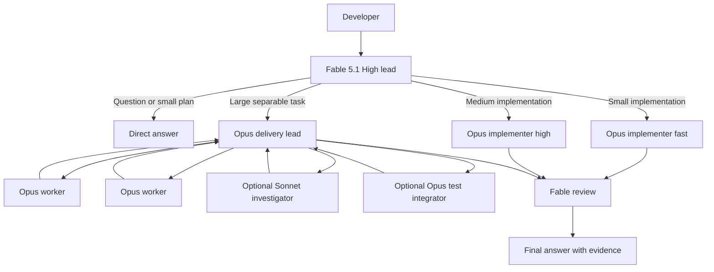

# Claude Code Extension State

This folder is the portable, sanitized source of truth for the native Claude
Code extension workflow used in VS Code. Claude runs through the authenticated
local Claude CLI and the Claude subscription directly. Kilo Gateway and
OpenRouter are not part of this path.

The snapshot was exercised with Claude Code `2.1.274` on 2026-09-19. Model
aliases and extension behavior can change, so rerun validation after upgrades.

## Workflow



Fable owns planning, architecture, supervision, review, and final acceptance.
Opus performs routine implementation. Sonnet is a bounded read-only
investigator. The hierarchy is capped at two subagent layers and six concurrent
subagents.

## Visible delegation

Every Agent call receives a distinct three-to-five-word subject. Fable announces
the subject, agent role, exclusive scope, and verification target before the
task starts. Claude Code then shows the task as an expandable row beneath the
prompt, including the agent type, live tool activity, status, and transcript.

VS Code's native Claude Focus view is enabled by `config/vscode-settings.json`.
It keeps thoughts, tool calls, command output, and agent prompts folded while a
compact live indicator reports the current activity. The full transcript and
agent tree remain one click away. This gives the default conversation a clean,
answer-first surface without hiding diagnostic detail permanently.

Substantial final responses follow a consistent reading order: `Answer`, an
optional `Verification` block, `My opinion`, and `Next step`. Each section uses
short paragraphs with deliberate spacing; routine command output and repeated
conclusions stay out of the narrative.

The layout remains native Claude Code rather than a pixel-for-pixel Kilo board,
but it exposes the same essential information on demand: subject, worker, work
performed, progress, and result.

## Files

- `config/settings.json`: safe user-level model and concurrency settings.
- `config/vscode-settings.json`: native Focus view and panel presentation.
- `config/CLAUDE.md`: Fable Engineering Lead routing and review policy.
- `config/agents/`: Opus and Sonnet custom agent definitions.
- `FABLE_ENGINEERING_LEAD.md`: operating, failure, and rollback notes.
- `scripts/validate.mjs`: no-model-cost static validation.

## Install

Back up the current `~/.claude` configuration first. Merge
`config/settings.json` into `~/.claude/settings.json`; do not overwrite unrelated
Claude settings. Copy `config/agents/*.md` into `~/.claude/agents/`. Merge the
Engineering Lead section of `config/CLAUDE.md` into `~/.claude/CLAUDE.md`.
Merge `config/vscode-settings.json` into VS Code's user `settings.json`.

The policy references `~/.config/ponytail/AGENTS.md`. Install the pinned policy
from `../third-party/ponytail/AGENTS.md` there, or replace the path consistently
in the policy and agent definitions.

Open a fresh Claude Code session after installation. Existing sessions may
retain their earlier instruction snapshot and model selection.

Validate this repository snapshot with:

```sh
node claude-code/scripts/validate.mjs
```

## Deliberately excluded

Never add Claude authentication files, OAuth data, session transcripts,
projects, file history, caches, usage records, debug logs, local backups, or
account identifiers to this folder.
