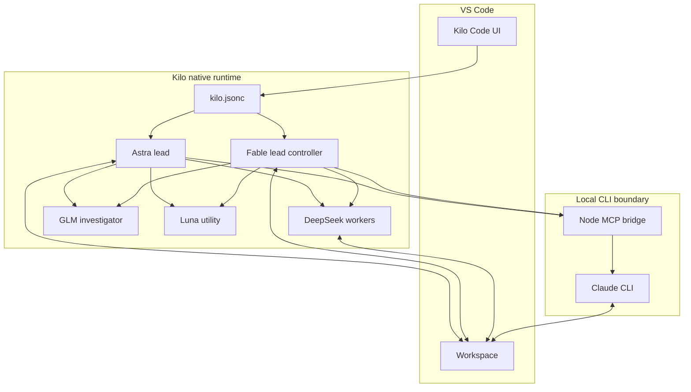

# Architecture

## Components

The system has four layers:

1. **VS Code** hosts the user interface and workspace.
2. **Kilo Code** supplies the agent runtime, tools, permissions, provider routing, task delegation, and shared workspace.
3. **Engineering leads and specialists** encode responsibility boundaries in Markdown agent definitions.
4. **The local bridge** supplies the Fable lead's primary execution route and exposes standalone Fable/Opus profiles through MCP.

## Native agents versus the local CLI

Astra, DeepSeek, GLM, and Luna run natively through Kilo providers. The Fable Engineering Lead is a Kilo controller whose primary work product is produced by the authenticated local Fable CLI. The controller can still coordinate Kilo-native specialists when justified.

The Claude CLI bridge is different. Kilo starts a small local MCP server, which launches an already authenticated Claude executable for a complete bounded task. That process can edit the same workspace, but it does not participate in Kilo's native shared board. The lead must inspect its result and resulting diff.

## Configuration boundaries

- `kilo.jsonc` selects default models, the default lead, delegation depth, display preferences, and MCP servers.
- `agent/*.md` defines model selection, permissions, step budgets, role prompts, and delegation rules.
- `instructions/*.md` defines the coding policy and the three-part user-facing response contract.
- The bridge defines local CLI profiles and translates MCP calls into CLI invocations.
- VS Code user settings control autonomous work style, auto-approval, notifications, panel placement, and command handling.
- The optional webview patch persists the selected agent across new and cleared sessions.
- Provider credentials live outside the repository in the keychain, Kilo auth storage, or official CLI authentication storage.

## Why the lead is the final owner

Delegation is useful for context isolation and parallel work, but it creates integration risk. Keeping one lead accountable prevents workers from independently declaring the overall task complete. The lead inspects changes, resolves cross-workstream inconsistencies, chooses final checks, and reports remaining limitations.
