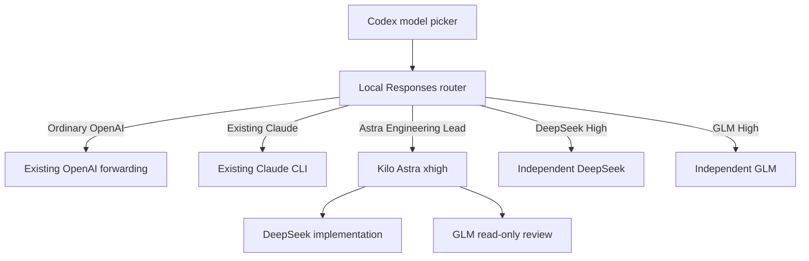

# Codex model picker: Astra lead, DeepSeek and GLM

The existing local OpenAI/Claude Responses router now also exposes three Kilo-backed selections. The integration reuses Kilo's authentication and coding tools. No credentials are copied into this repository.

| Selection | Execution | Reasoning | Delegation |
|---|---|---|---|
| Astra Engineering Lead | `openai/gpt-6-astra-fast` through Kilo | Default xhigh; high/max available | DeepSeek implementer/workstream lead and GLM investigator; image input |
| DeepSeek High | `deepseek/deepseek-flash` through Kilo | Default high; max available | Task tool denied; standalone coding; image input |
| GLM High | `openrouter/z-ai/glm-5.3-flash` through Kilo | Default high; max available | Task tool denied; standalone coding; image input |

Ordinary OpenAI models continue through the existing OpenAI forwarding function. Existing Claude selections keep their CLI route. No new globally available delegation tools are installed in Codex. Selecting the Astra lead activates the Kilo delegation configuration for that request only.

## Architecture



## Installation on the audited machine

The live service is `ai.codex.claude-router`, serving loopback port 43128. Its directory contains `router.mjs` and `kilo-route.mjs`. The Codex `combined` provider already points to this service. Preserve that provider and authentication setup.

For another machine, review `examples/codex-router/router.mjs` before deployment: it reuses the existing authenticated OpenAI Responses forwarding design and expects the host's model cache. Set `CODEX_CLAUDE_BINARY` for a different Claude executable. `CODEX_KILO_BINARY` optionally overrides automatic selection of the newest installed Kilo extension executable. These are local custom integration details, not a guarantee of compatibility with every Codex release.

The three new agents are supplied through per-process `KILO_CONFIG_CONTENT`; installing them does not modify the VS Code default agent. They load the existing Ponytail policy and response-style files. Astra reuses the installed `astra-engineering-lead.md` prompt and existing DeepSeek/GLM worker definitions.

After deployment, refresh/restart the Codex app if necessary to reload its model catalog. Existing tasks may retain their prior selection. Test a new task in a valid project workspace.

### Misleading “high demand” errors

The Codex app can present its generic “currently experiencing high demand” message when a local custom-model request fails before reaching the provider. Check the router's `stderr.log` before treating that message as a DeepSeek, GLM or Astra outage.

One confirmed cause is a saved Codex project whose directory was renamed or moved. Kilo routes deliberately require a valid absolute workspace and will reject a missing `<cwd>`. Update/reopen the Codex project at its new location, or retain the old path as a symlink to the renamed workspace when that mapping is unambiguous. The route accepts such a symlink and grants Kilo access to both the alias and its canonical target. Do not silently redirect an ambiguous missing workspace to the router's own directory.

The pre-change router is retained locally as `router.before-kilo-20260921.mjs`. To roll back, restore that file as `router.mjs` and restart the `ai.codex.claude-router` LaunchAgent. Leave credentials and the existing Codex provider configuration in place. The added module can remain unused.

## Permissions and limits

These are local CLI coding agents. Their tools run under Kilo permissions, not Codex's interactive approval flow. Workspace editing and shell commands are allowed for the requested coding workflow. Explicit task denials remain in effect for standalone models. Shell access is not an operating-system filesystem sandbox; use these modes in trusted workspaces.

- A valid absolute workspace is required; no fallback to the router's directory.
- New routes accept text plus PNG, JPEG, non-animated GIF and WEBP image uploads. The router preserves uploaded bytes in a temporary file, passes each file through Kilo's native `--file` option, and deletes the temporary directory after the run. Image analysis is supported; these routes do not generate image output. DeepSeek and GLM do not gain PDF input merely from image support.
- Each request starts a fresh Kilo run with the supplied conversation context. Kilo session IDs exist in Kilo, but its worker panels are not displayed as Codex-native subagents.
- Results arrive after the CLI completes; transport heartbeat messages keep the connection alive but are not progress reports.
- Disconnects terminate the Kilo process group. Runs have a ten-minute execution limit and never silently switch providers.
- Agents are instructed to preserve the output headings, but instructions do not guarantee identical model behavior or Astra-level quality. Live acceptance tests check a representative coding task and format.
- High/max are provider-supported settings confirmed in the installed Kilo metadata; model aliases and capabilities can change.

## Validation

Run the local configuration and transport checks:

```bash
node scripts/test-codex-routes.mjs
node scripts/test-codex-transport.mjs
```

The transport test uses a fake local CLI and a temporary port. It checks the model catalog, SSE completion/failure, cancellation, invalid effort, missing workspace, attachment forwarding, and unsupported image rejection without provider calls.

Live coding acceptance incurs provider usage and creates a disposable workspace:

```bash
node scripts/accept-codex-route.mjs deepseek-high
node scripts/accept-codex-route.mjs glm-high
node scripts/accept-codex-route.mjs astra-engineering-lead
```

Each run repairs a small input-validation/normalization function, runs independent assertions, preserves unrelated content and checks the three response headings. Astra must use both the DeepSeek implementer and GLM reviewer; standalone agents must not delegate. Pass `max` as a second argument to test that effort level. Temporary workspaces are retained for inspection.

User acceptance in the app: select each entry in a new task, confirm the expected route and report, then switch to an ordinary model and confirm no automatic Kilo delegation. This requires an actual UI refresh and is separate from backend verification.
