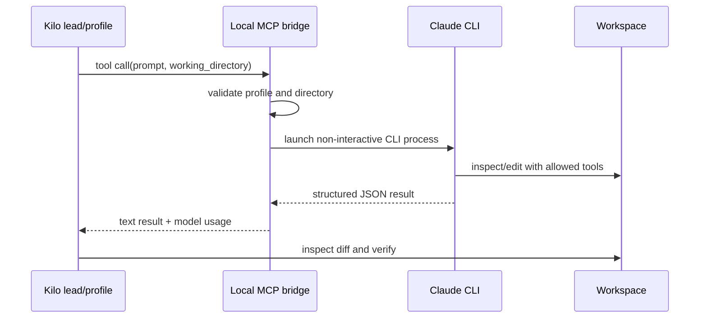

# Local Claude CLI bridge

## Purpose

The bridge exposes four complete-task profiles from an authenticated local Claude CLI to Kilo Code through MCP: Fable High, Fable Max, Opus Fast, and Opus High.

In this setup, the visible Fable Engineering Lead uses Fable High through this bridge for every request. Astra uses the bridge only for justified Opus escalation, and the remaining profile agents provide optional standalone routes.

## Configuration

The sample `kilo.jsonc` starts Node with two arguments: the bridge file and the absolute Claude executable path. Absolute paths are intentional because GUI applications often receive a reduced `PATH`.

The bridge:

- Accepts only declared profile names.
- Requires a non-empty prompt.
- Resolves and validates the working directory.
- Uses non-interactive JSON output.
- Stops active child processes when the MCP server shuts down.
- Returns bridge errors instead of silently changing models.

## Tool-mode overhead

A tool-mode step (Kilo owns the tools, the CLI only picks the next decision) replaces the full Claude Code harness prompt with the compact lead prompt in `examples/bridges/fable-lead-system.md`, copied live to `~/.config/kilo/bridges/fable-lead-system.md`, and describes the Kilo tool catalog only once per CLI session: later steps on the same session send a catalog marker. An invalid decision (for example `tool_call` with no calls) gets one corrective retry in the same CLI session (`decision_retry` event), which resends the full schemas if that step only sent the marker; a second invalid decision fails as before. Those runs also carry `CLAUDE_BRIDGE_TOOL_MODE=1` so workspace Stop hooks skip them. Conversation mode (Opus escalation, where the CLI runs tools itself) keeps the default harness prompt.

A resumed step sends only the messages the CLI has not seen plus any earlier message Kilo rewrote in place (compacted tool outputs, regrown system `<env>` block), instead of replaying the transcript whenever one old message stops matching. Sessions are matched on the conversation's second message hash and the longest common prefix, and persist to `~/.local/state/kilo/claude-cli-provider-state.json` across bridge restarts.

Streamed tool-mode steps use `--output-format stream-json --verbose --include-partial-messages`: a final answer's text arrives as deltas, while a tool-call decision is still released whole. Non-streamed requests keep plain JSON output. The live bridge is mirrored at `examples/bridges/claude-cli-provider.mjs`; `node claude-cli-provider.mjs --self-test` covers the prompt, catalog, session-delta and streaming-argument rules, plus the Codex arguments, event parsing, limits and environment against a stub CLI.

## Response latency (2026-10-13)

Three changes shorten the wait around each Claude step. None of them changes the model, the effort level or what the model sees, so answer quality is unchanged.

- **Reply on the result line.** A run settles as soon as the CLI prints its `{"type":"result"}` line instead of waiting for the process to exit, which took about 0.5 s. A process still alive 5 s later is terminated.
- **Visible progress.** Non-empty `thinking_delta` text is forwarded as `reasoning_content`. When a step produces neither thinking text nor answer text, the single status line (`<model> is working...`) now appears after 1.5 s instead of 10 s. In a sample of 1,260 Opus 5.5 thinking blocks, 1,019 arrived with empty text, so most steps show the status line.
- **Warm process.** Consecutive tool-mode steps of one chat reuse one long-lived CLI process started with `--input-format stream-json`; each step is one user line on stdin and one `result` line back.

### Warm process rules

| Setting | Default | Meaning |
|---|---|---|
| `CLAUDE_BRIDGE_WARM` | on | `0` restores one process per step |
| `CLAUDE_BRIDGE_WARM_IDLE_MS` | `600000` | An idle process ends after this long |
| `CLAUDE_BRIDGE_WARM_MAX` | `4` | Most processes kept alive; the least recently used idle one is ended first, and if all are busy the step runs one-shot |

- **Applies to:** Claude tool-mode streamed steps without image attachments. Conversation mode, non-streamed requests, image steps and the Codex backend keep the one-shot path.
- **Reuse key:** the CLI session id plus model, effort, working directory and tool catalog hash. A change in any of them ends the old process and starts a new one.
- **One process per session:** a new spawn for a session, warm or one-shot, first waits for that session's previous process to exit.
- **Failure:** if the process dies, is killed or a stdin write fails before anything was forwarded to the client, the step falls back to a one-shot `--resume` run. After output was forwarded it fails with the CLI error instead of hanging.
- **Cancel:** a client abort kills the process; the next step starts a fresh one.
- **Results:** an error result ends the process. An invalid decision keeps it, so the one corrective resend goes into the same process.
- **Shutdown:** idle processes end at once; a busy one finishes its step first.
- **Observability:** `/health` reports `warm: { enabled, limit, idleMs, processes: [{ pid, cwd, busy, idleForMs }] }`, and every `session_*` log line carries `warm` as `reused`, `spawned` or `off`.

### Measurements and limits

- **Where step time goes:** in 174 Opus 5.5 High steps, time tracked output tokens at about 95 tokens/s (under 300 tokens: 3.0 s median; over 3,000: 60 s). Context size, cache misses and queueing were not significant.
- **Warm saving:** on trivial low-effort steps a reused process took about 1.0 to 1.2 s against 1.5 to 1.6 s for a freshly started one, so roughly 0.4 to 0.5 s per step. This is a small sample, not a benchmark.
- **Memory:** about 250 to 340 MB per live process.
- **Fast mode:** the CLI reports `fast_mode_state: off` (`sdk_opt_in_required`) for bridge runs. `--settings '{"fastMode":true}'` turns it on, but it is billed from usage credits rather than the subscription plan, so the bridge does not enable it.
- **Not tested:** image steps under warm mode (they use the one-shot path by design) and several heavy chats at once.

### Checks

- `node claude-cli-provider.mjs --self-test` covers reuse with one spawn, fallback after a dead process, respawn on a changed tool catalog, the idle timeout, warm mode off, the `/health` shape and a process killed mid-step, all against a stub CLI.
- `node examples/bridges/check-claude-warm-process.mjs [--base http://127.0.0.1:32123] [--model opus-5-5-fast]` runs four real steps against a running bridge: answer, reuse of the same process, recovery after that process is killed, and a fresh process afterwards. It exits `0` on pass, `1` on failure and `2` when the bridge has no warm support. It spends a small amount of plan usage.
- To try a change safely, run a second bridge on another port with `CLAUDE_BRIDGE_PORT` and `CLAUDE_BRIDGE_STATE_FILE`, point the check at it with `--base`, and only then replace the live file.

## Codex backend

Model ids starting with `codex-` (`codex-gpt-6-astra-high`, `-xhigh`, `codex-gpt-6-sol-high`, `codex-gpt-6-luna-medium`, `codex-gpt-5.6-sol-high`, `-terra-high`, `-luna-medium`) run through the Codex CLI from the ChatGPT VS Code extension instead of the Claude CLI. The binary is resolved per request under `~/.vscode/extensions/openai.chatgpt-*/bin/*/codex` (override: `CODEX_BRIDGE_BINARY`) and must report `Logged in using ChatGPT`; otherwise the request fails with `codex_unavailable` and `/v1/models` hides the Codex ids. The bridge never reads `~/.codex/auth.json`, and strips every `OPENAI_*` and `CODEX_*` variable so only the ChatGPT plan is used.

- **Invocation:** `codex exec --json --ignore-user-config` with a read-only sandbox, the profile's model and reasoning effort, and images passed with `--image`. Sessions resume by Codex thread id.
- **Tool mode:** Codex's own tools (shell, exec, multi-agent, apps, plugins, browser, computer use, image tools, web search) are disabled; decisions come back through `--output-schema` with `arguments_json` strings, since OpenAI strict schemas forbid free-form objects. Output arrives whole, not as deltas.
- **Slots and sessions:** a separate pool of `CODEX_BRIDGE_CONCURRENCY` slots (default 3, max 8) beside `CLAUDE_BRIDGE_CONCURRENCY`, and 128 kept sessions per backend, so neither backend starves or evicts the other.
- **Limits:** ChatGPT plan messages (`usage limit`, `out of credits`, `spend cap`, `try again at 3:04 PM`) become a readable 429 until the reset time Codex printed. Unlike the Claude limit, this is kept in memory only. `/health` reports Codex slots and `limitedUntil` under `codex`.

`CLAUDE_BRIDGE_PORT` (default `32123`) and `CLAUDE_BRIDGE_STATE_FILE` override the listen port and session state file for either backend, for example to run a second bridge for testing.

## Operational boundary

The local CLI process does not join Kilo's native shared-agent board. The Kilo-side engineering lead/controller therefore remains responsible for inspecting the workspace diff and running a focused independent check before accepting it.

## Updating after an extension change

If the Claude executable comes from a versioned VS Code extension directory, an extension update can change its path. Update the final command argument in `kilo.jsonc`, restart VS Code, and repeat the bridge smoke check.
