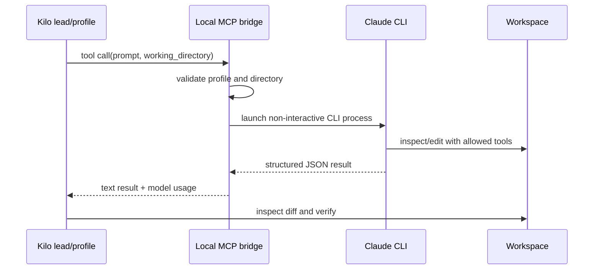

# Local Claude CLI bridge

## Purpose

The bridge exposes four complete-task profiles from an authenticated local Claude CLI to Kilo Code through MCP: Fable High, Fable Max, Opus Fast, and Opus High.

In this setup, the visible Fable Engineering Lead uses Fable High through this bridge for every request. Astra uses the bridge only for justified Opus escalation, and the remaining profile agents provide optional standalone routes.

## Configuration

The sample `kilo.jsonc` starts Node with two arguments: the bridge file and the absolute Claude executable path. Absolute paths are intentional because GUI applications often receive a reduced `PATH`.

The bridge:

- Accepts only declared profile names.
- Requires a non-empty prompt.
- Resolves and validates the working directory.
- Uses non-interactive JSON output.
- Stops active child processes when the MCP server shuts down.
- Returns bridge errors instead of silently changing models.

## Operational boundary

The local CLI process does not join Kilo's native shared-agent board. The Kilo-side engineering lead/controller therefore remains responsible for inspecting the workspace diff and running a focused independent check before accepting it.

## Updating after an extension change

If the Claude executable comes from a versioned VS Code extension directory, an extension update can change its path. Update the final command argument in `kilo.jsonc`, restart VS Code, and repeat the bridge smoke check.
