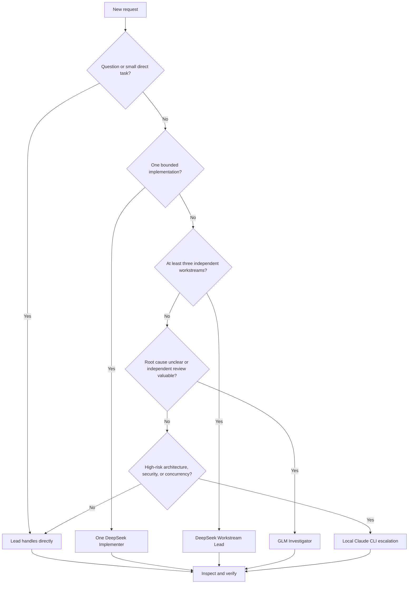

# Task routing and operating process

## Routing decision

## Assignment contract

Every delegated implementation should identify:

- The exact objective and expected behavior.
- Owned files or subsystem boundaries.
- Files and behaviors that must not change.
- The narrowest relevant test or verification command.
- Evidence expected in the completion report.

Writers must never overlap on the same files concurrently. Read-only investigations can run in parallel when they answer different questions.

## Example prompts

### Normal task

> Add server-side validation for the profile endpoint and update the focused tests. Keep the change scoped and verify the affected test target.

The lead decides whether direct work or one DeepSeek implementer is appropriate.

### Explicit bounded delegation

> Use one DeepSeek implementer for the backend validation. Give it exclusive ownership of the endpoint and its focused test file. Inspect its diff before finishing.

### Large separable task

> Implement the feature across frontend, API, and integration tests. Use separate workstreams only where file ownership does not overlap, then perform cross-workstream integration and final verification.

### Investigation

> Diagnose the regression without changing files. Use the GLM investigator if an independent read-only trace will materially improve confidence.

## Completion standard

The lead reports:

1. What changed.
2. Which files or subsystems were affected.
3. What was verified and the result.
4. Any remaining risk, limitation, or required external action.
