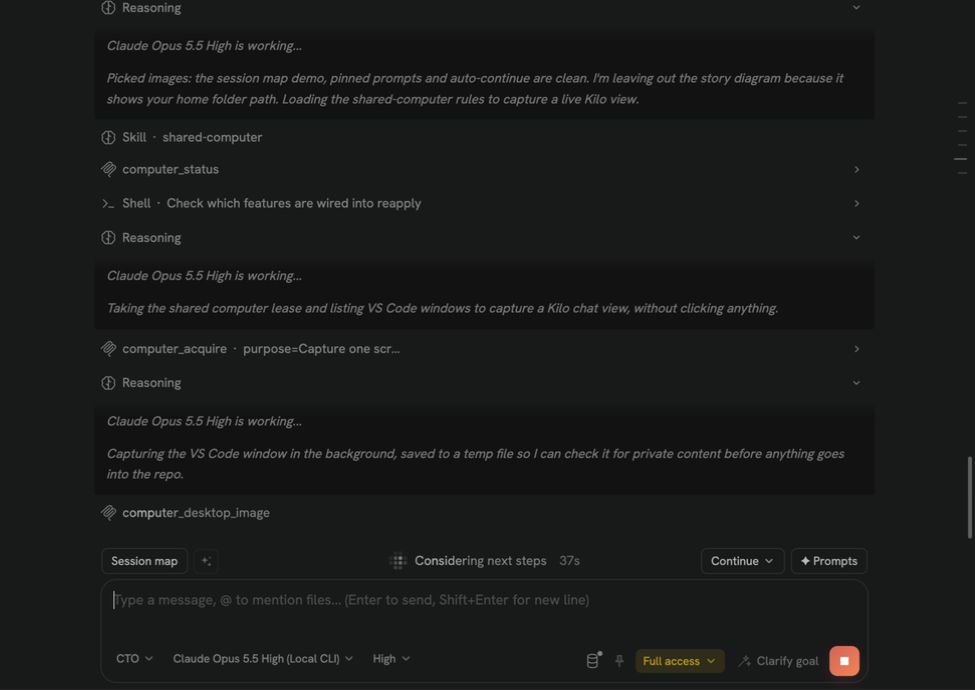
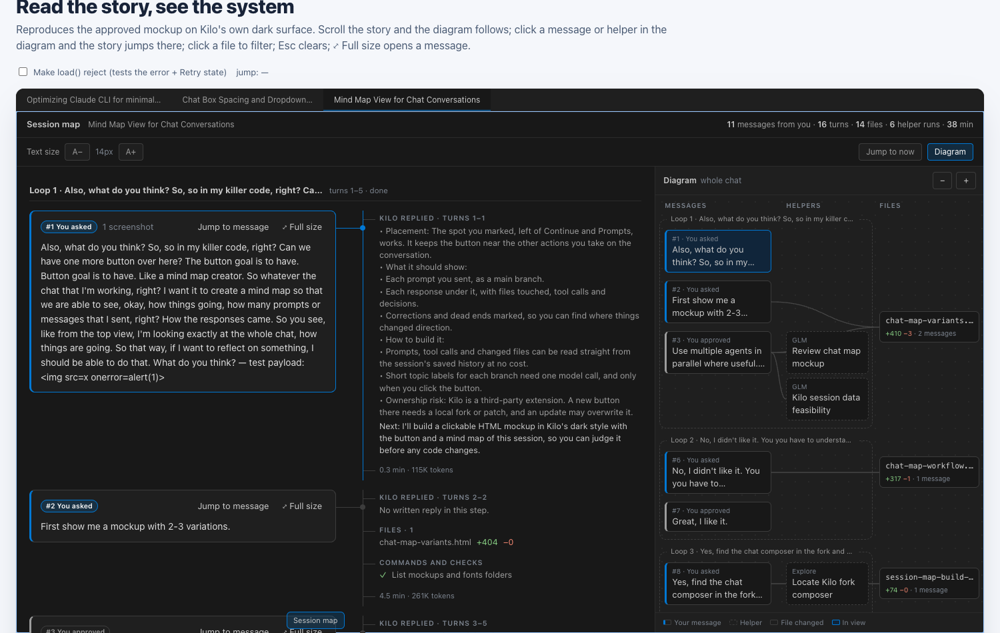
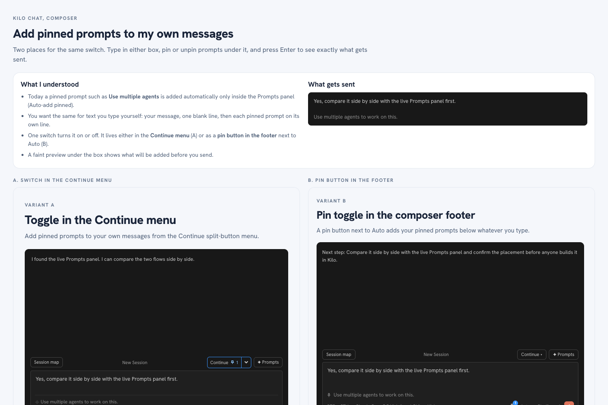

# Configuration snapshot — 2026-10-14b

Second capture on October 14, 2026 (America/Chicago). Restore or compare it through Git tag `config-2026-10-14b`.

It saves the Kilo Code work done after the morning snapshot: the Session map, pinned prompts on typed messages, a reasoning note on every Claude step, the CTO agents and the project skills. Only Kilo and VS Code configuration is included.

## What it looks like in Kilo

The Kilo chat with the local Claude bridge. Every tool step now shows a one-line note under *is working…*. The composer row carries **Session map**, **Continue**, **✦ Prompts**, the agent, model and effort pickers, the pin button and the permission menu.

### Session map

The Session map button opens an overlay over the chat. On the left is the story of each turn: your message, Kilo's reply, helpers, files and checks. On the right is a diagram of messages, helper agents and changed files. Scrolling the story moves the diagram, and clicking a node jumps to that turn.

### Pinned prompts on typed messages

Pinned Prompts-panel prompts are added below what you type, one per line. Two placements were mocked; the footer pin button (B) was built.

## Change index

| Area | What was saved | Source |
|---|---|---|
| Session map | Button left of ✦ Prompts, overlay, host-side session reader, turn grouping, CSS and its test | [`session-map.mjs`](../../examples/patches/session-map.mjs), [`session-map.cjs`](../../examples/patches/session-map.cjs), [`session-map-host.cjs`](../../examples/patches/session-map-host.cjs), [`session-map-ui.js`](../../examples/patches/session-map-ui.js), [`session-map-attach.js`](../../examples/patches/session-map-attach.js), [`session-map.css`](../../examples/patches/session-map.css), [test](../../examples/patches/session-map.test.cjs) |
| Pinned append | Footer pin button that adds pinned prompts to typed messages | [`pinned-append.mjs`](../../examples/patches/pinned-append.mjs), [`pinned-append-ui.js`](../../examples/patches/pinned-append-ui.js), [test](../../examples/patches/pinned-append.test.mjs) |
| Reasoning note | Tool-call decisions carry one short sentence that the bridge streams as reasoning before the calls; it never reaches the answer or the CLI transcript | [`claude-cli-provider.mjs`](../../examples/bridges/claude-cli-provider.mjs) (self-test covers it), [`fable-lead-system.md`](../../examples/bridges/fable-lead-system.md) |
| Chat scrolling | Scroll stability and effort isolation patches, plus a replay test for the smooth-follow glide (chat switch and reload land in one step; only a live reply glides) | [`chat-scroll-stability.mjs`](../../examples/patches/chat-scroll-stability.mjs), [`chat-effort-isolation.mjs`](../../examples/patches/chat-effort-isolation.mjs), [`smooth-follow.test.mjs`](../../examples/patches/smooth-follow.test.mjs) |
| Permissions and to-dos | Updated permission modes and engine test, to-dos in both views | [`permission-modes.mjs`](../../examples/patches/permission-modes.mjs), [engine test](../../scripts/test-permission-engine.mjs), [`todos-both-locations.mjs`](../../examples/patches/todos-both-locations.mjs) |
| Predicted next message, skim mode | Current live versions and tests | [`predict-next.cjs`](../../examples/patches/predict-next.cjs), [`skim-mode-ui.js`](../../examples/patches/skim-mode-ui.js) |
| Agents | `CTO (Recommended)`, `CTO + JEV`, `fable-engineering-lead`; current DeepSeek, GLM and engineering-lead agents | [`examples/agent/`](../../examples/agent/) |
| Goal policy | Mid-run steering: corrections, additions, stop and status messages handled at the next step | [`goal-policy.md`](../../examples/cto/goal-policy.md) |
| Skills | Seven project skills plus `shared-computer` | [`examples/skills/`](../../examples/skills/) |
| Bridge helpers | Claude MCP bridge with Opus and Sonnet routes (6 tools), stdin transport check, OpenRouter speed proxy, delivery rollback | [`examples/bridges/`](../../examples/bridges/), [`rollback.py`](../../examples/upgrades/delivery-v1/rollback.py) |
| Patch maintenance | The reapply script now applies Session map and pinned append; its test covers them and the Settings navigation colours | [Reapply script](../../scripts/reapply-kilo-patches.sh), [test](../../scripts/test-reapply-kilo-patches.mjs) |

## Verification and limits

- `bash scripts/verify.sh` passes. It now also runs the Session map and pinned append tests. The reapply test fixture gained the Settings navigation rules, the TypeSafe test lists `CTO + JEV` as a JEV agent, and the MCP bridge check expects 6 tools.
- Home folder paths were replaced with `~` in documents, `homedir()` or `$HOME` in code, and `/Users/demo` in test fixtures. A scan of the added files found no keys, tokens or email addresses.
- Files where the repository copy was newer than the machine (CTO manager, worker, server and policy, Luna, mockup standard, Peekaboo guard, two skills) were left as they were.

## Not in this snapshot

- **Glide and load-snap fix:** edited directly into the installed `webview.js`; it needs a patch script before it can be saved. Its replay test is included.
- **Prompt suggestions, local Claude favorites:** on the machine but not applied by the reapply script.
- **Auto-continue:** mockup only. **`claude-cli-provider.next.mjs`:** draft. **Session map demo data:** contains a real chat transcript.
