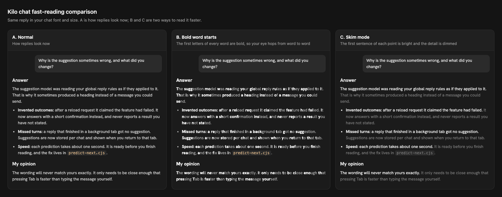

# Skim mode

Fast reading for AI chat replies. The first sentence of each paragraph and list item stays at full brightness and the rest of it is dimmed, so you can read the point of every item first and only read the detail you need.



## Status

- **Live in Kilo Code** since 2026-10-13 (snapshot `config-2026-10-13`), in the sidebar chat and the Agent Manager.
- **On by default.** Ctrl+Option+S (Ctrl+Alt+S on Windows and Linux) turns it off and on, and the choice is remembered.

## What we compared

| Option | Idea | Decision |
|---|---|---|
| A. Normal | Replies as they looked before | Reference |
| B. Bold word starts | The first letters of every word are bold | Not chosen: every word competes for attention and the text looks unusual |
| C. Skim mode | The first sentence of each point is bright, the detail is dimmed | Chosen and built |

The comparison is [`mockup/index.html`](mockup/index.html). GitHub shows HTML as source, so download the folder and open the file in a browser. It uses the Hanken Grotesk font stored beside it.

## How it works

- **Paints, never edits.** It uses the CSS Custom Highlight API, so the reply text, copying, search and screen readers are unchanged.
- **Points only.** Paragraphs and list items in assistant replies are dimmed; code blocks and tables are left alone.
- **Careful sentence ends.** A sentence ends only before a capital letter, a digit or a code span, so abbreviations such as "e.g." and numbers such as 1.2 do not split. Very short first sentences or remainders stay fully bright.
- **Streaming.** The last block of a reply that is still being written stays bright until it settles.
- **Accessibility.** It switches itself off in high-contrast and forced-colours modes.

## Files

| File | Role |
|---|---|
| [`../examples/patches/skim-mode.mjs`](../examples/patches/skim-mode.mjs) | Kilo installer with `--apply`, `--check` and `--restore` |
| [`../examples/patches/skim-mode-ui.js`](../examples/patches/skim-mode-ui.js) | The helper that runs in the chat page |
| [`../examples/patches/skim-mode.test.mjs`](../examples/patches/skim-mode.test.mjs) | Test of the installer and the sentence rules |
| [`../examples/patches/skim-mode.fixture.html`](../examples/patches/skim-mode.fixture.html) | Sample reply used by the test |
| [`mockup/index.html`](mockup/index.html) | The A, B and C comparison |
| [`prompt.md`](prompt.md) | Prompt for adding skim mode to other apps |

## Install and check in Kilo

```bash
node examples/patches/skim-mode.test.mjs
node examples/patches/skim-mode.mjs <path to dist/webview.js>
node examples/patches/skim-mode.mjs <path to dist/agent-manager.js>
node examples/patches/skim-mode.mjs <path to dist/webview.js> --check
```

Run **Developer: Reload Window** afterwards. [`scripts/reapply-kilo-patches.sh`](../scripts/reapply-kilo-patches.sh) puts the patch back after Kilo updates. More detail is in [Chat reading and composer patches](../docs/chat-ui-patches.md#skim-mode).

## Use it in other apps

[`prompt.md`](prompt.md) holds a ready prompt for a coding agent. It points to the Kilo helper as the reference, so the tuned sentence rules are reused instead of rewritten.

## Limits

- Text in scripts without capital letters, such as Chinese or Japanese, stays fully bright.
- It needs the CSS Custom Highlight API. Chromium-based apps such as VS Code and Electron apps support it; check other browsers before relying on it.
